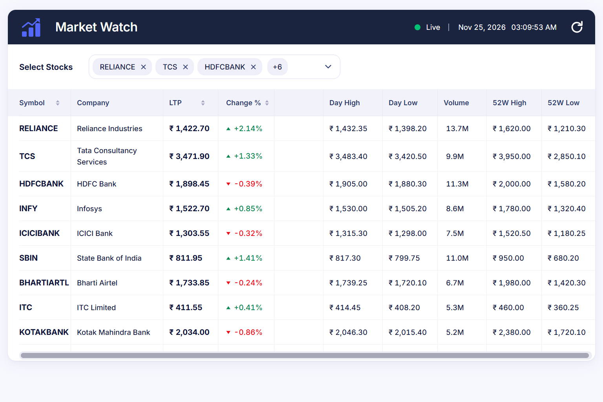
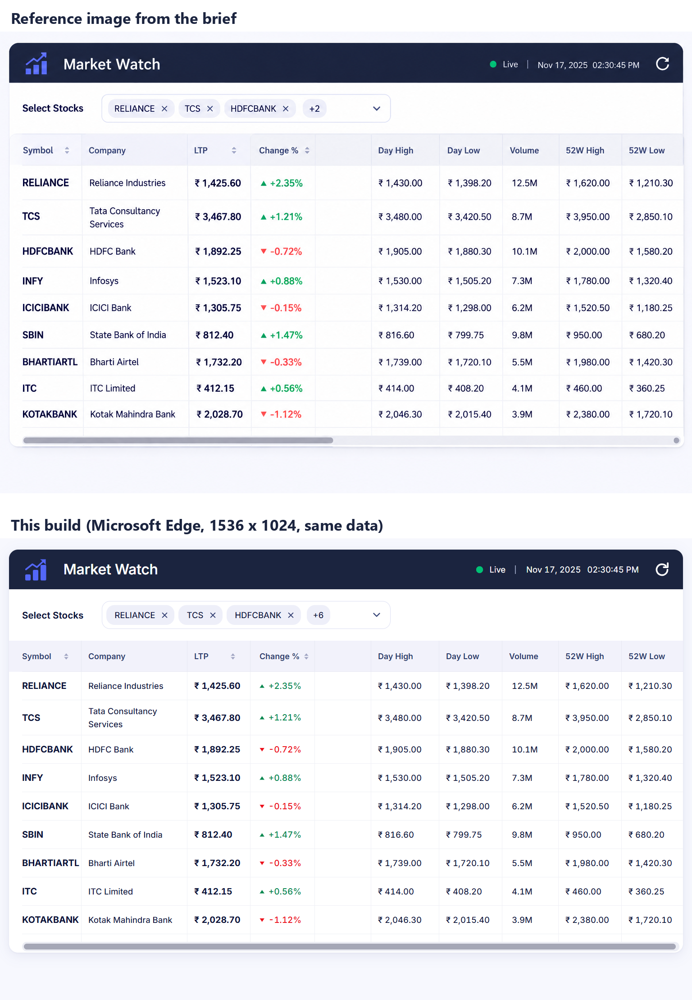
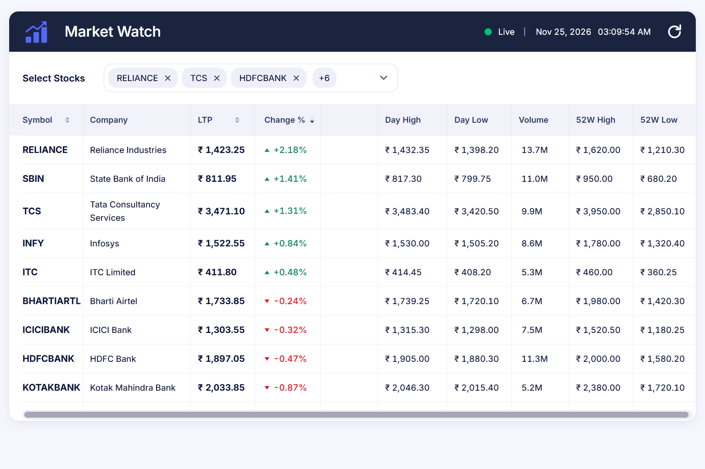
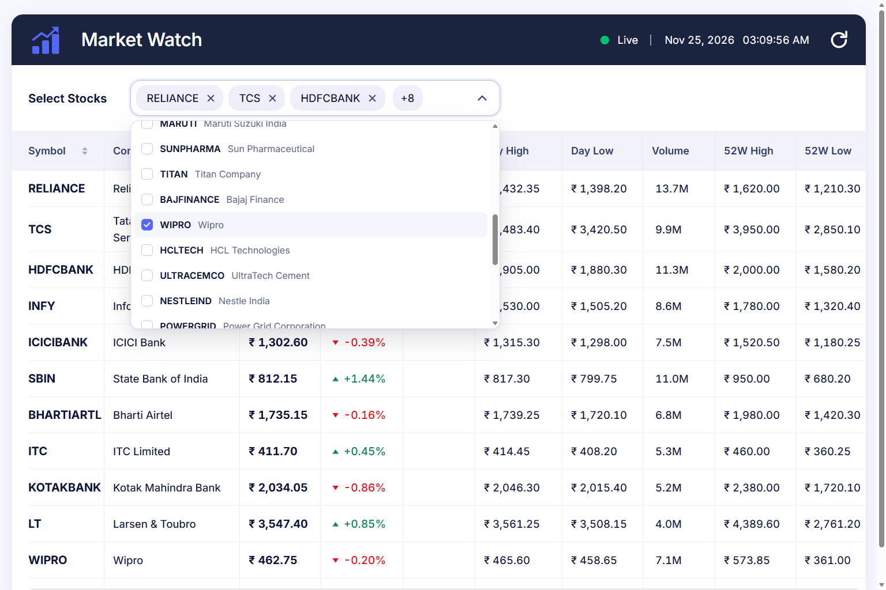
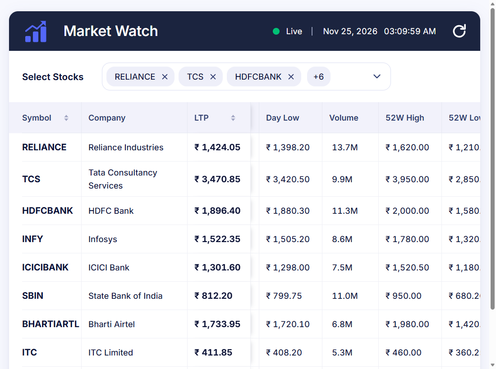
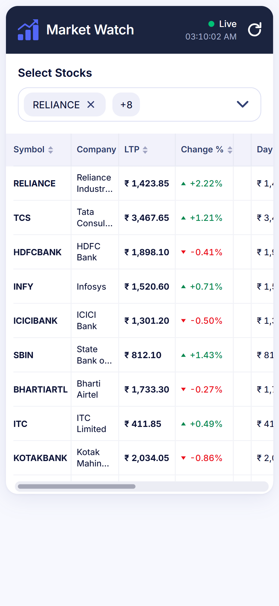
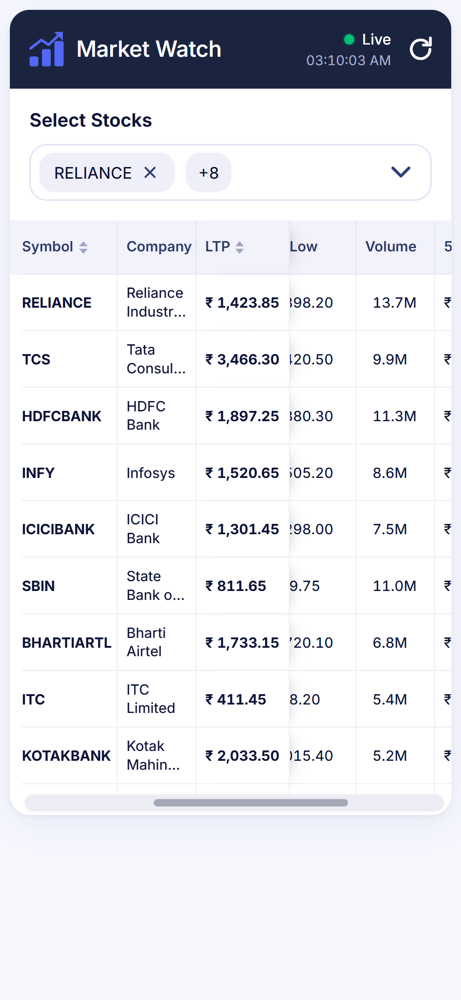
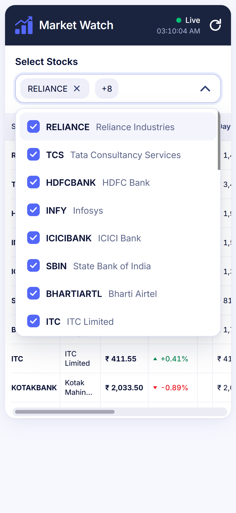
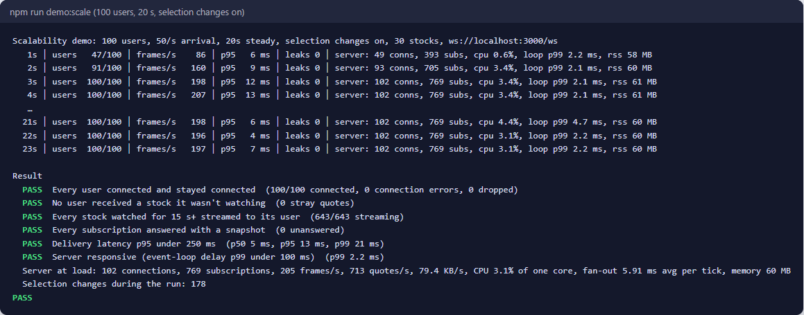
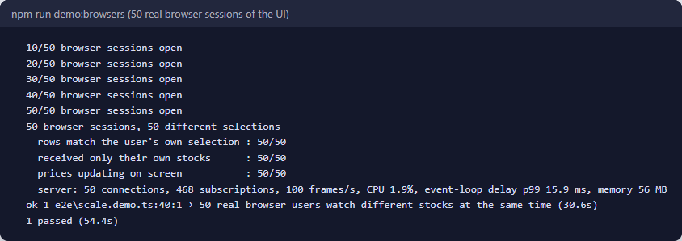

# Market Watch
### Built By: Sanskar

A live stock price table. A NestJS server makes up the prices and sends them to the browser over WebSockets. The React page updates only the cells that change.



## Requirements

- Node.js 22.18 or newer
- npm (comes with Node.js)

## Setup

Run this once in the project folder:

```bash
npm install
```

This installs both the backend and the frontend.

## Run the application locally

```bash
npm run dev
```

- App: http://localhost:5173
- API: http://localhost:3000

Open the app in two browser windows and pick different stocks in each. Each window gets its own prices.

To run the production build:

```bash
npm run build
```

```bash
npm start -w backend
```

```bash
npm run preview -w frontend
```

The app then runs on http://localhost:4173.

Settings are optional. Copy `backend/.env.example` to `backend/.env` to change them:

| Setting            | Default | Meaning                      |
| ------------------ | ------- | ---------------------------- |
| `STOCK_COUNT`      | 30      | Number of stocks to simulate |
| `TICK_INTERVAL_MS` | 500     | How often prices change (ms) |
| `PORT`             | 3000    | API port                     |

To run the tests:

```bash
npm run check
```

```bash
npm run e2e
```

## Architectural decisions

- **One price simulator on the server.** It updates the prices every 500 ms and all users share it.
- **Plain WebSockets.** The server uses NestJS with `ws`. The browser uses its built-in WebSocket. No Socket.IO.
- **Each user gets only their own stocks.** The server keeps a list of who watches each stock. On each update, a user gets one message with only their changed prices.
- **Slow users get the latest price.** If a connection falls behind, the server keeps only the newest price for each stock, so the user never sees old data.
- **Only changed cells re-render.** Each table cell listens to one value, for example the price of TCS. When that value changes, only that cell updates.
- **Table built by hand.** No table library. The table uses CSS grid. The first three columns stay fixed while the rest scroll sideways.
- **Stock list over HTTP.** The dropdown list never changes, so it loads once over HTTP. Prices go over the WebSocket.

## Assumptions

- Prices are simulated. The first nine stocks start at the values in the reference image.
- The empty column between Change % and Day High is kept, as in the reference.
- All nine stocks start selected, so the chip shows "+6" (the reference shows "+2").
- All rows have the same height.
- The green and red colours are a little darker so the text is easier to read.
- The sort arrows sort the table. A third click goes back to the original order.
- New stocks are added at the bottom of the table.
- The refresh button asks the server for fresh prices and reconnects if the connection is lost.
- The clock shows Indian market time.
- The reference has no phone design, so the phone layout is a smaller version of the desktop one.

## Scalability (50+ users)

Start the app with `npm run dev`, then in a second terminal run:

```bash
npm run demo:scale
```

This connects 100 users. Each user watches different stocks and changes them during the test. It checks that every user stays connected, gets updates on time and never gets another user's stocks.

To test with 50 real browser windows of the app:

```bash
npm run demo:browsers
```

Results on a single laptop:

| Test                 | Users | Result | Delay (p95) | Server CPU | Server memory |
| -------------------- | ----- | ------ | ----------- | ---------- | ------------- |
| Real browser windows | 50    | Pass   | n/a         | 1.9%       | 56 MB         |
| Simulated users      | 100   | Pass   | 13 ms       | 3.1%       | 60 MB         |
| Simulated users      | 200   | Pass   | 16 ms       | 5.9%       | 78 MB         |
| Simulated users      | 1000  | Pass   | 53 ms       | 11.9%      | 120 MB        |

No test had a dropped user or a user receiving the wrong stocks.

## Screenshots

**Reference image (top) and this build (bottom).**



**Sorted by Change %.**



**Adding stocks from the dropdown.**



**Scrolled sideways. The first three columns stay in place.**



**Phone.**



**Phone, scrolled.**



**Phone, dropdown open.**



**Scalability test with 100 users.**



**Scalability test with 50 browser windows.**


